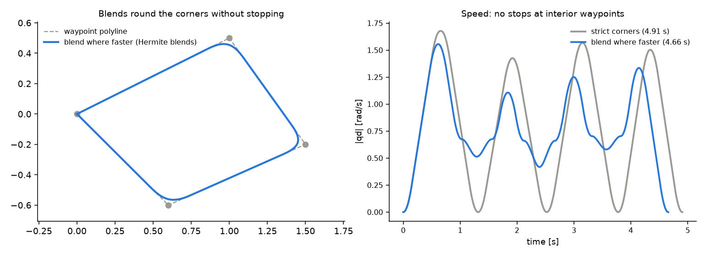

# justblend

[](https://github.com/justagist/justblend/actions/workflows/ci.yml)
[](https://pypi.org/project/justblend/)
[](https://pypi.org/project/justblend/)
[](https://en.cppreference.com/w/cpp/17)
[](LICENSE)

Closed-form N-dimensional trajectory generation with smooth corner blends.
General-purpose: joint trajectories, Cartesian paths, CNC tool paths,
animation curves -- anywhere you have a list of points in some
D-dimensional space and want a velocity/acceleration/jerk-limited smooth
trajectory through them.



## Highlights

- **Analytic segments, microsecond generation.** No optimisation over a
  discretised path: typical multi-waypoint problems generate in a few
  microseconds (tens with `BLEND_WHERE_FASTER` on S-curves), and match
  ruckig's per-segment time-optimal durations on polyline motions (see
  [benchmarks](benchmarks/README.md)).
- **Two velocity profiles.** Bang-bang **trapezoidal** for the fastest
  rest-to-rest motion, or 7-phase jerk-limited **S-curve** when jerk
  limits are given.
- **Four corner modes, two blend shapes.** Stop at every waypoint, blend
  every corner, blend wherever a blend fits, or blend only where that is
  faster than stopping. The cubic-Hermite blend has zero acceleration at
  its boundaries, so an S-curve trajectory stays jerk-limited through the
  corner.
- **Analytic guarantees.** Limits are satisfied by construction; the
  corner-cut deviation and per-waypoint passage times come back in
  closed form.
- **Boundary speeds and duration stretching** for moving-start
  replanning and speed control.
- **C++17 and Python.** Static library with clean CMake exports;
  pybind11 bindings with type stubs.

The output `Trajectory` is lazy: it owns a list of analytic segments and
can be sampled at any time `t` in `[0, duration]` without precomputing a
dense buffer.

## Getting started -- C++

```cpp
#include <justblend/justblend.hpp>

Eigen::MatrixXd waypoints(4, 2);
waypoints << 0.0, 0.0,
             1.0, 0.5,
             1.5,-0.2,
             0.0, 0.0;

justblend::Limits limits;
limits.v_max = (Eigen::VectorXd(2) << 1.5, 1.2).finished();
limits.a_max = (Eigen::VectorXd(2) << 3.0, 2.5).finished();
limits.j_max = (Eigen::VectorXd(2) << 20.0, 18.0).finished();

justblend::GenerationOptions opts;
opts.blend_radius = 0.15;
opts.corner_handling = justblend::CornerHandling::BLEND_WHERE_FASTER;

justblend::SCurveTrajectoryGenerator gen(2);
gen.setLimits(limits);
gen.setOptions(opts);

auto traj = gen.generate(waypoints);
auto s = traj.sample(0.5);          // single sample
auto dense = traj.samples(0.002);   // uniform dt sweep
```

## Getting started -- Python

```python
import numpy as np
import justblend as jb

waypoints = np.array([[0.0, 0.0], [1.0, 0.5], [1.5, -0.2], [0.0, 0.0]])
limits = jb.Limits(
    v_max=np.array([1.5, 1.2]),
    a_max=np.array([3.0, 2.5]),
    j_max=np.array([20.0, 18.0]),
)
opts = jb.GenerationOptions(
    blend_radius=0.15,
    corner_handling=jb.CornerHandling.BLEND_WHERE_FASTER,
)

gen = jb.SCurveTrajectoryGenerator(dim=2)
gen.set_limits(limits)
gen.set_options(opts)
traj = gen.generate(waypoints)

s = traj.sample(0.5)
dense = traj.samples(dt=0.002)
arbitrary = traj.samples(np.linspace(0, traj.duration(), 1000))
```

All input-validation failures throw `justblend::ValidationError`, which the
Python bindings raise as a `ValueError` subclass.

## Corner handling

| Mode | At each corner | Where a blend cannot be used |
|---|---|---|
| `STRICT_CORNERS` (default) | stops | -- |
| `BLEND_ALL` | blends | raises `ValidationError` |
| `BLEND_WHERE_FEASIBLE` | blends wherever a blend can be used | stops |
| `BLEND_WHERE_FASTER` | blends only where that is faster than stopping | stops |

Blends cut the corner: the trajectory does not pass through a blended
waypoint. [Corner handling](docs/corner_handling.md) compares the modes,
with their costs and when to use each, and covers blend radii, deviation
bounds, blend shapes and collinear waypoints.

## Documentation

- [Corner handling](docs/corner_handling.md) -- the four modes, blend radius
  and shape, corner deviation.
- [Timing and sampling](docs/timing_and_sampling.md) -- boundary speeds,
  limit scaling, timing queries, sampling and its conventions.
- [Algorithms](docs/algorithms.md) -- how a trajectory is built.
- [Benchmarks](benchmarks/README.md) -- comparison with ruckig and toppra.
- [Changelog](CHANGELOG.md)

The figures regenerate with `python docs/generate_figures.py`.

## Install -- C++

Requirements: CMake ≥ 3.18, a C++17 compiler, and Eigen 3.3+ (any package
that exposes `find_package(Eigen3 NO_MODULE)` -- the Debian/Ubuntu
`libeigen3-dev` package, vcpkg, conan, brew, or a manual install all work).

### Build and install to a prefix

```bash
cmake -S . -B build -DCMAKE_BUILD_TYPE=Release \
    -DJUSTBLEND_BUILD_TESTS=OFF \
    -DJUSTBLEND_BUILD_EXAMPLES=OFF \
    -DJUSTBLEND_BUILD_PYTHON_BINDINGS=OFF
cmake --build build --parallel
cmake --install build --prefix /your/install/prefix    # omit --prefix for /usr/local
```

This installs:

- `<prefix>/include/justblend/*.hpp`
- `<prefix>/lib/libjustblend.a`
- `<prefix>/lib/cmake/justblend/justblend{Config,ConfigVersion,Targets}.cmake`

### Use from another CMake project

After installing, consume justblend with `find_package`:

```cmake
find_package(justblend 0.3 REQUIRED)

add_executable(my_app main.cpp)
target_link_libraries(my_app PRIVATE justblend::justblend)
```

Then configure your project with `-DCMAKE_PREFIX_PATH=/your/install/prefix`
(or set `justblend_DIR=<prefix>/lib/cmake/justblend`).

You don't have to install: justblend also exports its targets from the
build tree, so pointing `CMAKE_PREFIX_PATH` at the build directory works
just as well.

To vendor justblend as a subdirectory (git submodule, FetchContent, or a
plain copy), drop `add_subdirectory(path/to/justblend)` into your
`CMakeLists.txt` -- the same `justblend::justblend` target becomes
available, and the test / example / Python-binding targets stay OFF by
default when consumed this way.

### Run tests and examples

```bash
cmake -S . -B build -DJUSTBLEND_BUILD_TESTS=ON -DJUSTBLEND_BUILD_EXAMPLES=ON
cmake --build build --parallel
ctest --test-dir build --output-on-failure
./build/examples/cpp/example_basic_2d
```

## Install -- Python

```bash
pip install .
```

`pip install` fetches `scikit-build-core` and `pybind11` automatically and
drives the same CMake build under the hood -- no separate C++ install step
needed. Eigen 3.3+ must still be installed on the host.

## License

MIT -- see [LICENSE](LICENSE).
