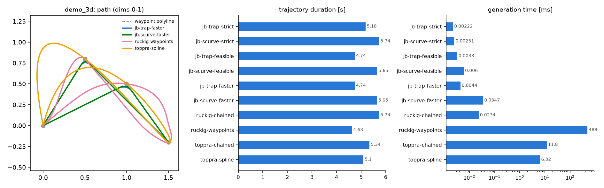
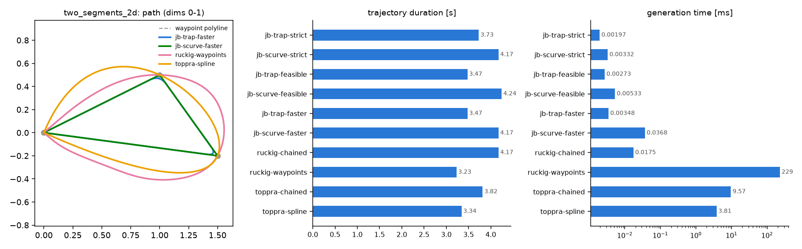

# justblend benchmarks

Comparison of justblend against [ruckig](https://github.com/pantor/ruckig)
(community edition) and [toppra](https://github.com/hungpham2511/toppra) on
shared waypoint scenarios.

**This file is generated** by `benchmarks/run.py`; do not edit it by hand.

## Running

```bash
pip install .[bench,plot]
python benchmarks/run.py [--dt 0.001]
```

## Methods

| method | profile | corner handling | path |
|---|---|---|---|
| jb-trap-strict | trapezoidal | full stop at every waypoint | exact polyline |
| jb-trap-feasible | trapezoidal | parabolic blends wherever a blend fits | polyline with rounded corners |
| jb-trap-faster | trapezoidal | parabolic blends where faster than stopping | polyline with rounded corners |
| jb-scurve-strict | jerk-limited S-curve | full stop at every waypoint | exact polyline |
| jb-scurve-feasible | jerk-limited S-curve | Hermite blends wherever a blend fits | polyline with rounded corners |
| jb-scurve-faster | jerk-limited S-curve | Hermite blends where faster than stopping | polyline with rounded corners |
| ruckig-chained | jerk-limited | full stop at every waypoint | unconstrained between waypoints (per-axis profiles) |
| ruckig-waypoints | jerk-limited | passes through waypoints at speed | unconstrained (per-axis profiles through waypoints) |
| toppra-chained | vel/acc time-optimal | full stop at every waypoint | exact polyline |
| toppra-spline | vel/acc time-optimal | passes through waypoints at speed | cubic spline through waypoints |

ruckig-waypoints uses `intermediate_positions`; the community edition solves
it via ruckig's **cloud API** (Ruckig Pro solves it locally), so its
generation time includes a network round trip and the scenario data leaves
the machine. toppra has no jerk constraint.

## Results

### demo_3d (5 waypoints, 3 dof, blend_radius=0.15)

| method | duration [s] | compute [ms] | vel | acc | jerk | polyline dev | wp miss |
|---|---|---|---|---|---|---|---|
| jb-trap-strict | 5.180 | 0.00222 | 1.000 | 1.000 | 233.33 | 0.0000 | 0.0000 |
| jb-scurve-strict | 5.736 | 0.00251 | 1.000 | 1.000 | 1.00 | 0.0000 | 0.0000 |
| jb-trap-feasible | 4.738 | 0.0033 | 1.000 | 1.000 | 150.00 | 0.0373 | 0.0640 |
| jb-scurve-feasible | 5.655 | 0.006 | 1.000 | 1.000 | 1.00 | 0.0280 | 0.0480 |
| jb-trap-faster | 4.738 | 0.0044 | 1.000 | 1.000 | 150.00 | 0.0373 | 0.0640 |
| jb-scurve-faster | 5.650 | 0.0347 | 1.000 | 1.000 | 1.00 | 0.0280 | 0.0475 |
| ruckig-chained | 5.736 | 0.0234 | 1.000 | 1.000 | 1.00 | 0.0445 | 0.0000 |
| ruckig-waypoints | 4.628 | 488 | 1.000 | 1.000 | 1.00 | 0.3072 | 0.0005 |
| toppra-chained | 5.340 | 11.8 | 1.000 | 1.000 | 110.83 | 0.0000 | 0.0000 |
| toppra-spline | 5.095 | 6.32 | 1.001 | 1.000 | 99.37 | 0.4942 | 0.0007 |



### two_segments_2d (4 waypoints, 2 dof, blend_radius=0.1)

| method | duration [s] | compute [ms] | vel | acc | jerk | polyline dev | wp miss |
|---|---|---|---|---|---|---|---|
| jb-trap-strict | 3.730 | 0.00197 | 1.000 | 1.000 | 239.29 | 0.0000 | 0.0000 |
| jb-scurve-strict | 4.173 | 0.00332 | 1.000 | 1.000 | 1.00 | 0.0000 | 0.0000 |
| jb-trap-feasible | 3.475 | 0.00273 | 1.000 | 1.000 | 150.00 | 0.0246 | 0.0459 |
| jb-scurve-feasible | 4.243 | 0.00533 | 1.000 | 1.000 | 1.00 | 0.0185 | 0.0344 |
| jb-trap-faster | 3.475 | 0.00348 | 1.000 | 1.000 | 150.00 | 0.0246 | 0.0459 |
| jb-scurve-faster | 4.173 | 0.0368 | 1.000 | 1.000 | 1.00 | 0.0000 | 0.0000 |
| ruckig-chained | 4.173 | 0.0175 | 1.000 | 1.000 | 1.00 | 0.0329 | 0.0000 |
| ruckig-waypoints | 3.229 | 229 | 1.000 | 1.000 | 1.00 | 0.2764 | 0.0005 |
| toppra-chained | 3.817 | 9.57 | 1.000 | 1.000 | 122.01 | 0.0000 | 0.0000 |
| toppra-spline | 3.344 | 3.81 | 1.001 | 1.000 | 115.78 | 0.2681 | 0.0003 |



### joints_6dof (6 waypoints, 6 dof, blend_radius=0.15)

| method | duration [s] | compute [ms] | vel | acc | jerk | polyline dev | wp miss |
|---|---|---|---|---|---|---|---|
| jb-trap-strict | 8.018 | 0.00296 | 1.000 | 1.000 | 106.69 | 0.0000 | 0.0000 |
| jb-scurve-strict | 8.518 | 0.00321 | 1.000 | 1.000 | 1.00 | 0.0000 | 0.0000 |
| jb-trap-feasible | 7.541 | 0.00455 | 1.000 | 1.000 | 100.00 | 0.0372 | 0.0671 |
| jb-scurve-feasible | 8.423 | 0.00508 | 1.000 | 1.000 | 1.00 | 0.0280 | 0.0503 |
| jb-trap-faster | 7.541 | 0.00598 | 1.000 | 1.000 | 100.00 | 0.0372 | 0.0671 |
| jb-scurve-faster | 8.405 | 0.0111 | 1.000 | 1.000 | 1.00 | 0.0280 | 0.0493 |
| ruckig-chained | 8.518 | 0.0384 | 1.000 | 1.000 | 1.00 | 0.0960 | 0.0000 |
| ruckig-waypoints | 6.983 | 386 | 1.000 | 1.000 | 1.00 | 0.8929 | 0.0016 |
| toppra-chained | 8.143 | 22.4 | 1.000 | 1.000 | 91.21 | 0.0000 | 0.0000 |
| toppra-spline | 7.849 | 12.5 | 1.001 | 1.004 | 79.50 | 1.1988 | 0.0005 |


## Metric definitions

- **vel / acc / jerk**: peak per-axis ratio against the corresponding limit
  (<= 1 means the limit is respected). Jerk is finite-differenced from
  sampled accelerations, so large values indicate acceleration steps --
  expected for trapezoidal profiles, parabolic blends, ruckig segment
  boundaries and toppra (no jerk constraint).
- **polyline dev**: max distance from the sampled path to the waypoint
  polyline.
- **wp miss**: worst closest approach to any interior waypoint.

## Reading the numbers

- jb-*-strict and toppra-chained solve the identical polyline-with-stops
  problem. jb-trap-strict is analytically time-optimal there; toppra's grid
  discretisation makes it slightly conservative.
- jb-scurve-strict has matched ruckig-chained's duration on all scenarios to
  date: for straight rest-to-rest legs where the same axis binds the limits,
  the closed-form path profile is per-axis time-optimal.
- ruckig-chained moves each axis independently between waypoints, so its
  path leaves the polyline (see polyline dev) even though it stops at every
  waypoint.
- ruckig-waypoints passes through every waypoint without stopping (wp miss
  ~0) but its path between waypoints is unconstrained; its generation time
  is dominated by the cloud-API round trip in the community edition.
- jb-*-feasible rounds every corner a blend fits, which can be slower than
  stopping where a blend's speed cap slows the neighbouring segments.
  jb-*-faster rounds a corner only where that is faster than stopping, so it
  is never slower than jb-*-strict, at a higher generation cost. Corner
  deviations are bounded and reported by `Trajectory::maxCornerDeviation()`.
- toppra-spline follows a smooth spline through all waypoints without
  stopping: shortest durations, but an unconstrained-jerk, non-polyline
  path.
