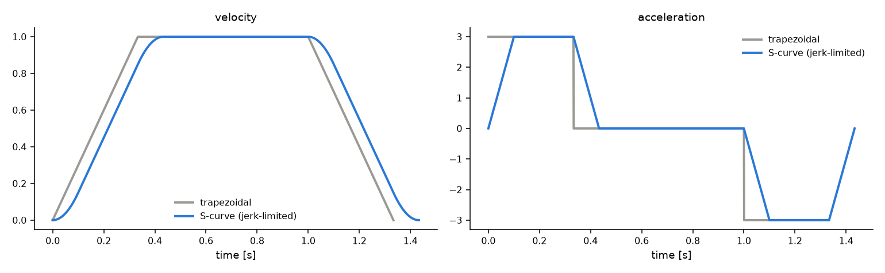

# Algorithms

How `generate()` turns waypoints and limits into a trajectory. There is no
numerical optimisation over a discretised path: each step is closed form, a
bounded bisection, or, for `BLEND_WHERE_FASTER`, a search over which corners
to blend.



## Overview

1. Check the inputs and apply the scaling factors to `v_max` and `a_max`.
2. Merge collinear waypoints, giving the reduced path: a polyline of
   straight legs.
3. Turn the per-axis limits into path limits for each leg.
4. Decide which corners may blend, with what radius and speed cap.
5. Solve the speed at every junction with a forward and a backward pass.
6. For `BLEND_WHERE_FASTER`, choose which corners to blend.
7. Build the segments: a speed profile along each leg, a blend at each
   blended corner.

The result is a lazy `Trajectory` that evaluates its segments on demand.

## Collinear merging

A run of waypoints is merged into one leg when every inner waypoint lies
within `1e-6` times the run's length of the run's chord, and the inner
waypoints appear in order along it. Each run starts at the first waypoint
not yet merged; its end is found by doubling the run length until the test
fails, then bisecting back. Every merged run is checked waypoint by
waypoint, so the search costs `O(n log n)` on long straight runs instead of
`O(n^2)`.

## Path limits per leg

Along a straight leg with unit direction `u`, axis `i` moves at `|u_i|` times
the path speed. The leg's path limits are therefore the tightest of the
per-axis limits divided by `|u_i|`:

```text
sd_max   = min_i v_max_i / |u_i|
sdd_max  = min_i a_max_i / |u_i|
sddd_max = min_i j_max_i / |u_i|     (S-curve only)
```

Keeping the path speed profile within these keeps every axis within its own
limits.

## Corners and blend speed caps

In the modes that blend, each corner gets a radius: the requested one (or
the one that meets `max_corner_deviation`), clipped to half the shorter
neighbouring leg and so that the blend does not start before a merged
waypoint. Near-reversals and radii below `1e-9` cannot be blended.

A blend joins the incoming direction `d_in` to the outgoing direction
`d_out` over the last `r` of one leg and the first `r` of the next. It
starts at velocity `V d_in`, ends at `V d_out` and takes `2r / V`, where `V`
is the corner speed. With
`delta = d_out - d_in`, the per-axis limits bound `V` by:

| Limit | Parabolic blend | Hermite blend |
|---|---|---|
| velocity | `min_i v_max_i / max(abs(d_in_i), abs(d_out_i))` | same |
| acceleration | `sqrt(2 r min_i a_max_i / abs(delta_i))` | `sqrt(4/3 r min_i a_max_i / abs(delta_i))` |
| jerk | -- | `cbrt(2/3 r^2 min_i j_max_i / abs(delta_i))` (S-curve only) |

The blend's cap is the smallest of these. Inside the blend:

- **Parabolic**: constant acceleration `V^2 / (2r) * delta`, so the velocity
  turns linearly from `V d_in` to `V d_out`. Acceleration steps at both ends.
- **Hermite**: velocity `V (d_in + alpha(tau) delta)` with
  `alpha(tau) = 3 tau^2 - 2 tau^3` and `tau` the fraction of the blend time.
  Acceleration is zero at both ends, and the jerk changes linearly across
  the blend.

## Junction speeds

Each vertex of the reduced path gets a junction speed `U`: zero at a stop,
at most the cap at a blend, and the requested boundary speed at either end.

- **Forward pass**: from the start, each junction speed is the lower of its
  cap and the highest speed reachable from the previous junction over the
  straight part of the leg between them.
- **Backward pass**: from the end, each junction speed is lowered again to
  what can still be slowed down to the next junction's speed.

The reachable speed over a length `D` from `v0` is `sqrt(v0^2 + 2 a D)` for
the trapezoidal profile. For the S-curve profile it is found by bisecting
the speed (80 steps) on the closed-form distance of a jerk-limited ramp.

A blend whose junction speed comes out below `1e-6` has collapsed: it turns
into a stop and the passes run again, or `BLEND_ALL` raises.

## Choosing the fastest corners

`BLEND_WHERE_FASTER` starts from the plan with every possible corner blended
and improves it one corner at a time:

1. For each candidate corner, switch it between blend and stop, measure how
   the total duration changes, and switch it back.
2. Apply the switch that shortens the trajectory most, if any does. Repeat.
3. When no single switch helps, compare with stopping at every candidate and
   keep the faster.

Switching a corner only changes the junction speeds near it, so each trial
re-solves the speeds outward from the corner and stops where they no longer
change. The result of each trial is cached until an applied switch lands
next to its range. Step 3 catches cases where every single switch makes
things slower but stopping everywhere is faster.

The result is never slower than the starting plan (the
`BLEND_WHERE_FEASIBLE` choice) or than stopping at every corner. In testing against an exhaustive search on 1000 random S-curve paths
it found the fastest choice every time; it is not proven optimal in general.

## Segments

Each leg's straight part becomes a linear segment with a speed profile from
its start junction speed to its end junction speed:

- **Trapezoidal**: accelerate at `sdd_max`, cruise at `sd_max`, decelerate.
  When the leg is too short to reach `sd_max`, the peak speed comes in closed
  form.
- **S-curve**: each speed change is a jerk-limited ramp of up to three
  phases (jerk, constant acceleration, jerk), with a cruise between, so up
  to seven phases per leg. When the leg is too short to reach `sd_max`, the
  peak speed is found by bisection (80 steps).

Each blended corner becomes a blend segment, as above.

## Sampling

The trajectory keeps its segments and their start times. A sample finds its
segment by binary search on the start times and evaluates the segment in
closed form, so it costs `O(log n)` in the number of segments and needs no
precomputed buffer. `sampleInto` (C++) does the same into caller-owned
storage without allocating. See [Timing and sampling](timing_and_sampling.md)
for the sampling conventions.
