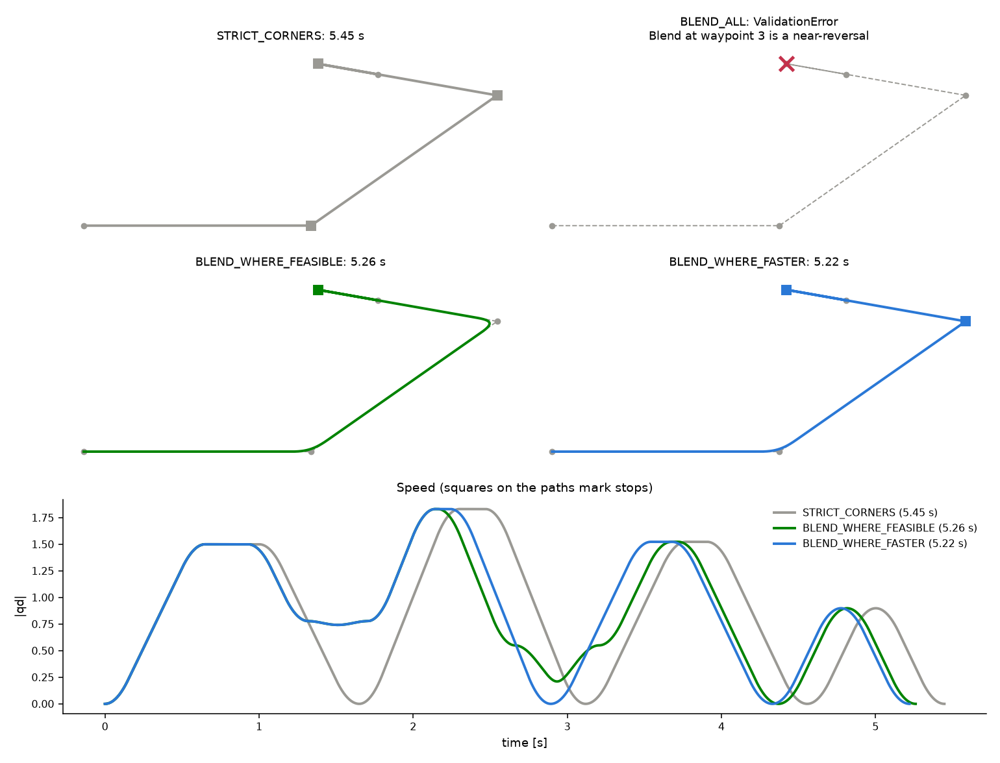

# Corner handling

A corner is an interior waypoint where the path changes direction. At each
corner the trajectory either stops on the waypoint or rounds it with a blend
that cuts the corner without stopping. `GenerationOptions::corner_handling`
picks how that choice is made.

## The four modes

| Mode | At each corner | Where a blend cannot be used | Generation cost |
|---|---|---|---|
| `STRICT_CORNERS` (default) | stops | -- | lowest |
| `BLEND_ALL` | blends | raises `ValidationError` | about 2x strict |
| `BLEND_WHERE_FEASIBLE` | blends wherever a blend can be used | stops | same as `BLEND_ALL` |
| `BLEND_WHERE_FASTER` | blends only where that is faster than stopping | stops | up to about 40x strict |

A blend cannot be used at a corner that turns back within about 2.6 degrees
of a full reversal, where the radius left after clipping is below `1e-9`, or
where the limits force the blend's speed to zero. See
[Corner details](#corner-details).

The path above has three corners: a gentle one where a blend saves time, a
hairpin where the blend's speed cap makes it slower than stopping, and a spur
that doubles back on itself, which cannot be blended. Squares mark stops.

- `STRICT_CORNERS` stops at all three (5.45 s).
- `BLEND_ALL` rejects the path because of the spur.
- `BLEND_WHERE_FEASIBLE` blends the gentle corner and the hairpin, and stops
  at the spur (5.26 s).
- `BLEND_WHERE_FASTER` blends only the gentle corner (5.22 s): stopping at
  the hairpin is faster than the slow blend.

## Choosing a mode

**`STRICT_CORNERS`** passes exactly through every waypoint and is the
cheapest to generate. Every corner costs a full stop, so it gives the longest
trajectory. Use it when the waypoints themselves must be reached, for example
for pick and place targets or contact points.

**`BLEND_ALL`** guarantees that the motion never stops at an interior
waypoint, or tells you that it cannot. Use it when a stop part way along
would be a fault, for example for a dispensing or cutting path, and you would
rather reject the path than stop. It can be slower than stopping at a sharp
corner.

**`BLEND_WHERE_FEASIBLE`** keeps the motion as continuous as the path
allows: it never fails because of a corner, and stops only where it has to.
It costs the same as `BLEND_ALL`. Like `BLEND_ALL`, it can be slower than
stopping at a sharp corner; on the `two_segments_2d`
[benchmark](../benchmarks/README.md) with S-curve and Hermite blends it takes
4.243 s against 4.173 s for `STRICT_CORNERS`.

**`BLEND_WHERE_FASTER`** gives the shortest trajectory of the four modes'
corner choices: it is never slower than `STRICT_CORNERS` or than blending
every corner that allows it. It may stop at corners that could have been
blended, so the motion is less continuous, and which corners stop depends on
the limits as well as the geometry. Generation costs much more with S-curve
profiles (see [Generation cost](#generation-cost)). Use it when cycle time
matters and the path is planned ahead rather than in a tight loop.

When every corner can be blended, `BLEND_ALL` and `BLEND_WHERE_FEASIBLE` give
the identical trajectory.

## Why a blend can be slower than a stop

A blend is crossed at its corner speed `V`, which is capped by the limits and
the corner's sharpness (see [Algorithms](algorithms.md#corners-and-blend-speed-caps)).
The cap falls as the corner gets sharper or the radius smaller (as
`sqrt(r)`, or as `r^(2/3)` under a jerk limit). At a hairpin the cap can be well below the
speed the neighbouring segments could reach. The trajectory then has to slow
to `V` before the corner, cross the blend slowly, and ramp back up, while the
blend has also taken `2r` of straight path away from the segments. A stop
gives each segment its full length to accelerate and decelerate at the
limits, which can take less time.

On the trapezoidal profile this is rare, because its parabolic blends allow
higher corner speeds and no jerk limit applies. On the random paths below,
`BLEND_WHERE_FASTER` saved up to 3 % of the S-curve duration over
`BLEND_WHERE_FEASIBLE`, and under 0.02 % on the trapezoidal profile.

## Generation cost

Time per `generate()` call on random 2D paths, blend radius 0.1, measured on
one core; absolute times vary by machine. `BLEND_ALL` raised on the 100 and 500 waypoint
paths, which contain near-reversals.

| Waypoints | Profile | `STRICT_CORNERS` | `BLEND_WHERE_FEASIBLE` | `BLEND_WHERE_FASTER` |
|---|---|---|---|---|
| 5 | trapezoidal | 2.2 µs | 3.3 µs | 4.3 µs |
| 5 | S-curve | 4.8 µs | 9.1 µs | 75 µs |
| 20 | trapezoidal | 8.8 µs | 14 µs | 20 µs |
| 20 | S-curve | 20 µs | 45 µs | 0.77 ms |
| 100 | trapezoidal | 38 µs | 66 µs | 97 µs |
| 100 | S-curve | 0.12 ms | 0.23 ms | 4.4 ms |
| 500 | trapezoidal | 0.18 ms | 0.38 ms | 0.49 ms |
| 500 | S-curve | 0.60 ms | 1.1 ms | 25 ms |

`BLEND_WHERE_FASTER` tries switching corners between blend and stop and
re-solves the affected junction speeds each time. On S-curve profiles each
junction speed takes a short bisection, so the search dominates. See
[Algorithms](algorithms.md#choosing-the-fastest-corners).

## Corner details

### Blend radius

- `blend_radius` is the cut-back distance along each segment next to the
  corner, not an arc radius: a blend replaces the last `r` of the incoming
  segment and the first `r` of the outgoing one.
- `blend_radii` sets a radius per interior waypoint instead. A single entry
  applies to every corner.
- In every mode the radius is clipped to half the shorter neighbouring
  segment, so neighbouring blends never overlap, and so that a blend never
  starts before a merged collinear waypoint. `Trajectory::blendRadii()`
  reports the radius actually used.

### Bounding the corner cut

A blended corner is not passed exactly: the trajectory cuts it. The distance
from the waypoint to the trajectory at its passage time is
`(r/4) |d_out - d_in|` for parabolic blends and `(3r/16) |d_out - d_in|` for
Hermite blends, where `d_in` and `d_out` are the unit directions of the
segments either side. `Trajectory::cornerDeviations()` reports it per
waypoint.

To bound that distance instead of the radius, set `max_corner_deviation`.
Each corner then uses the largest radius whose deviation stays within it,
still clipped as above, and `blend_radius` is ignored. Gentle corners get
large blends, sharp corners small ones. It cannot be combined with
`blend_radii`. Where a waypoint must be reached exactly, use
`STRICT_CORNERS`.

### Blend shapes

- **Hermite** (default for `SCurveTrajectoryGenerator`): a cubic blend with
  zero acceleration at both ends, so an S-curve trajectory stays
  jerk-limited through the corner.
- **Parabolic** (default for `TrapezoidalTrajectoryGenerator`): constant
  acceleration through the corner. It allows a higher corner speed than a
  Hermite blend of the same radius, but its acceleration steps at both ends.

Setting `blend_shape = PARABOLIC` on the S-curve generator keeps the
velocity and acceleration limits but gives unbounded jerk at the blend ends.

### Collinear waypoints

Waypoints on a straight line are merged into one segment in every mode, so
the profile keeps accelerating through them instead of being split at each.
A waypoint counts as collinear when it lies within `1e-6` times the run's
length of the straight line through the run, in order along it. It is passed
at speed and reported as `PASS`, missed by at most that distance, which
`cornerDeviations()` reports. A waypoint where the path doubles back along
the same line is not merged.

### Corners that cannot be blended

- **Near-reversals**: corners that turn back within about 2.6 degrees of a
  full reversal. The blend would have to turn through almost 180 degrees in
  the space of `2r`.
- **Radius too small**: the radius after clipping is below `1e-9`, for
  example because a neighbouring segment is almost zero length.
- **Collapsed blends**: the speed the limits allow at the blend falls below
  `1e-6`, for example on a very short segment with a very low jerk limit.

`BLEND_ALL` raises a `ValidationError` naming the waypoint. The
`BLEND_WHERE_*` modes stop there instead.
